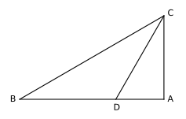
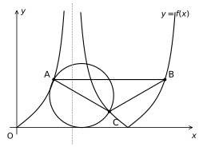
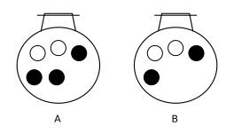
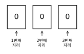

# 강대모의고사K 23회 변형 문항 — 확률과 통계 선택자용

- 원본: 2027학년도 대학수학능력시험 강대모의고사K 23회(홀수형)
- 범위: 공통 8, 9, 10, 11, 12, 13, 14, 18, 19, 20번 + 확률과 통계 25, 26, 27, 28, 29번
- 원문의 문장·조건·구조는 그대로 두고 **숫자만 바꾼** 문항입니다. 문항 번호는 원문 번호를 그대로 사용했고, 그림은 새 수치에 맞게 다시 그렸습니다. 공통 10문항은 세 과목 시험지에 동일하게 들어갑니다.

---

## 공통과목

### 5지선다형

**8.** 상수 $a\,(a>1)$에 대하여 곡선 $y=\log_a(x+3)$의 점근선이 곡선 $y=\log_a(-x)$와 만나는 점을 A라 하자. $\overline{\mathrm{OA}}=5$일 때, $a$의 값은? (단, O는 원점이다.) [3점]

① $3^{\frac15}$  ② $3^{\frac14}$  ③ $3^{\frac13}$  ④ $3^{\frac12}$  ⑤ $3$

**9.** 함수 $f(x)=x^3+nx^2-24x$가 $1<x<2$에서 극값을 갖도록 하는 자연수 $n$의 개수는? [4점]

① 4  ② 5  ③ 6  ④ 7  ⑤ 8

**10.** 공비가 양수인 등비수열 $\{a_n\}$이
$$27a_1+9a_2=3a_3+a_4=1$$
을 만족시킬 때, $a_5$의 값은? [4점]

① $\dfrac12$  ② $1$  ③ $\dfrac32$  ④ $2$  ⑤ $3$

**11.** 두 점 P와 Q는 시각 $t=0$일 때 각각 점 A(1)과 점 B(3)에서 출발하여 수직선 위를 움직인다. 두 점 P, Q의 시각 $t\,(t\ge 0)$에서의 속도는 각각
$$v_1(t)=3t^2-2t+2,\qquad v_2(t)=2t+1$$
이다. 두 점 P, Q의 위치가 같아지는 시각에서 점 Q의 속도는? [4점]

① 2  ② 3  ③ 4  ④ 5  ⑤ 6

**12.** 그림과 같이 $\overline{\mathrm{AB}}=6$인 삼각형 ABC에서 선분 AB를 $1:2$로 내분하는 점 D에 대하여 $\overline{\mathrm{CD}}=4$이다. 삼각형 ADC의 외접원과 삼각형 BCD의 외접원의 넓이의 비가 $1:4$일 때, $\overline{\mathrm{AC}}\times\overline{\mathrm{BC}}$의 값은? [4점]

① 18  ② 21  ③ 24  ④ 27  ⑤ 30

**13.** 함수 $f(x)=x^2-8x+28$과 양수 $t$에 대하여 함수
$$g(x)=\begin{cases} f(x) & (x<t)\\[2pt] \dfrac{f(t)}{t}\,x & (x\ge t)\end{cases}$$
의 그래프와 직선 $y=28$로 둘러싸인 도형의 넓이를 $S(t)$라 하자. 양의 실수 전체의 집합에서 정의된 함수 $S(t)$에 대하여 <보기>에서 옳은 것만을 있는 대로 고른 것은? [4점]

> **<보기>**
> ㄱ. $S(4)=\dfrac{256}{3}$
> ㄴ. 함수 $S(t)$는 $t=\sqrt7$에서 극대이다.
> ㄷ. $t\ge a$인 모든 실수 $t$에 대하여 $S(t)=S(b)$가 되도록 하는 서로 다른 두 양수 $a,\ b$가 존재할 때, $a+b$의 최솟값은 12이다.

① ㄱ  ② ㄷ  ③ ㄱ, ㄴ  ④ ㄱ, ㄷ  ⑤ ㄱ, ㄴ, ㄷ

**14.** 상수 $k\,(k>0)$에 대하여 집합 $\left\{x \,\middle|\, 0\le x<\dfrac{3k\pi}{2},\ x\ne\dfrac{k\pi}{2}\right\}$에서 정의된 함수 $f(x)=\left|\tan\dfrac{x}{k}\right|$가 있다. 함수 $f(x)$의 그래프 위의 서로 다른 세 점 A$(a,\,f(a))\left(\dfrac{k\pi}{4}<a<\dfrac{k\pi}{2}\right)$, B, C에 대하여 직선 AB는 $x$축과 평행하고 $\overline{\mathrm{AC}}=\overline{\mathrm{BC}}=\dfrac{4}{3}\sqrt3$이다. 선분 AC를 지름으로 하는 원이 $x$축과 한 점에서만 만날 때, 삼각형 ABC의 넓이는? (단, $a$는 상수이다.) [4점]

① $\dfrac23\sqrt3$  ② $\sqrt3$  ③ $\dfrac43\sqrt3$  ④ $\dfrac53\sqrt3$  ⑤ $2\sqrt3$

### 단답형

**18.** 방정식 $\log_2 x+\log_8 (x-6)^3=4$를 만족시키는 실수 $x$의 값을 구하시오. [3점]

**19.** 상수 $a$에 대하여 함수 $f(x)=4x^3+ax$의 한 부정적분을 $F(x)$라 하고, 함수 $g(x)=3x^2+4$의 한 부정적분을 $G(x)$라 하자.
$$F(1)=G(1),\qquad F(2)=G(2)$$
일 때, $f(3)$의 값을 구하시오. [3점]

**20.** 모든 항이 자연수인 수열 $\{a_n\}$이 모든 자연수 $n$에 대하여
$$a_{n+1}=\begin{cases} a_n+2 & (a_n<a_1)\\ -a_n+16 & (a_n\ge a_1)\end{cases}$$
을 만족시킨다. 다음은 $a_1=a_{25}$가 되도록 하는 모든 $a_1$의 값의 합을 구하는 과정이다.

> 수열 $\{a_n\}$의 모든 항이 자연수이고, $a_2=-a_1+16$이므로
> $$1\le a_1\le 15 \qquad\cdots\cdots\ ㉠$$
> 이다. $a_1=a_{25}$에서 $a_1=a_{n+1}$인 자연수 $n$의 최솟값이 존재하고, 이 값을 $m$이라 하면
> $$a_1=a_{m+1}=a_{2m+1}=\cdots=a_{24+1}$$
> 이므로
> $m$은 $\boxed{\text{(가)}}$의 양의 약수 $\qquad\cdots\cdots\ ㉡$
> 이다.
>
> (ⅰ) $a_2<a_1$인 경우
> $a_{m+1}=a_2+2(m-1)=-a_1+2m+14$
> 이므로 ㉠과 ㉡에 의하여 이 경우의 모든 $a_1$의 값의 합은 $\boxed{\text{(나)}}$이다.
>
> (ⅱ) $a_2\ge a_1$인 경우
> $a_3=-a_2+16=a_1$
> 이므로 이 경우는 $a_1=a_{25}$를 만족시킨다. ㉠에 의하여 이 경우의 모든 $a_1$의 값의 합은 $\boxed{\text{(다)}}$이다.
>
> (ⅰ), (ⅱ)에 의하여 $a_1=a_{25}$가 되도록 하는 모든 $a_1$의 값의 합은 $\boxed{\text{(나)}}+\boxed{\text{(다)}}$이다.

위의 (가), (나), (다)에 알맞은 수를 각각 $p,\ q,\ r$이라 할 때, $p+q+r$의 값을 구하시오. [4점]

---

## 선택과목(확률과 통계)

### 5지선다형

**25.** 주머니 A에는 흰 공 2개와 검은 공 3개가 들어 있고, 주머니 B에는 흰 공 2개와 검은 공 2개가 들어 있다. 주머니 A에서 임의로 한 개의 공을 꺼내어 주머니 B에 넣은 후 주머니 B에서 임의로 한 개의 공을 꺼낼 때, 이 공이 검은 공일 확률은? [3점]

① $\dfrac{11}{25}$  ② $\dfrac{12}{25}$  ③ $\dfrac{13}{25}$  ④ $\dfrac{14}{25}$  ⑤ $\dfrac35$

**26.** $\left(x-\dfrac{1}{x^n}\right)^{30}$의 전개식에서 음수인 상수항이 존재하도록 하는 자연수 $n$의 개수는? [3점]

① 1  ② 2  ③ 3  ④ 4  ⑤ 5

**27.** 어느 농장에서 수확하는 애호박 1개의 무게는 평균이 $m$, 표준편차가 30인 정규분포를 따른다고 한다. 이 농장에서 수확하는 애호박 중에서 $n$개를 임의추출하여 얻은 표본평균을 이용하여 구한 $m$에 대한 신뢰도 95%의 신뢰구간이 $a\le m\le 269.7$이다. 이 농장에서 수확하는 애호박 중에서 $4n$개를 임의추출하여 얻은 표본평균을 이용하여 구한 $m$에 대한 신뢰도 99%의 신뢰구간이 $214.7\le m\le a+10$이다. $n+a$의 값은? (단, 무게의 단위는 g이고, $Z$가 표준정규분포를 따르는 확률변수일 때, $\mathrm{P}(|Z|\le1.96)=0.95$, $\mathrm{P}(|Z|\le2.58)=0.99$로 계산한다.) [3점]

① 238.5  ② 239  ③ 239.5  ④ 240  ⑤ 240.5

**28.** 앞면에는 숫자 0, 뒷면에는 숫자 1이 적혀 있는 3장의 카드가 있다. 이 3장의 카드가 그림과 같이 모두 앞면이 보이도록 놓여 있다.

이 3장의 카드와 한 개의 동전을 사용하여 다음 시행을 한다.

> 동전을 한 번 던져
> 앞면이 나오면
> 3장의 카드 중 임의로 2장의 카드를 선택하여 이 2장의 카드를 모두 보이는 면을 유지한 채 서로 자리를 바꾸어 놓고,
> 뒷면이 나오면
> 3장의 카드 중 임의로 1장의 카드를 선택하여 이 1장의 카드를 한 번 뒤집어 제자리에 놓는다.

이 시행을 5번 반복한 후 3장의 카드에 보이는 수가 모두 0일 때, 2번째 시행 후 3장의 카드에 보이는 수가 모두 0일 확률은? [4점]

① $\dfrac{7}{19}$  ② $\dfrac{8}{19}$  ③ $\dfrac{9}{19}$  ④ $\dfrac{10}{19}$  ⑤ $\dfrac{11}{19}$

### 단답형

**29.** 다음 조건을 만족시키는 자연수 $a_1,\ a_2,\ a_3,\ a_4,\ a_5$의 모든 순서쌍 $(a_1,\,a_2,\,a_3,\,a_4,\,a_5)$의 개수를 구하시오. [4점]

> (가) $2\le a_1\le a_2\le a_3\le a_4\le a_5\le 9$
> (나) $a_n\times a_{n+1}=18$인 자연수 $n\,(1\le n\le4)$가 존재한다.
